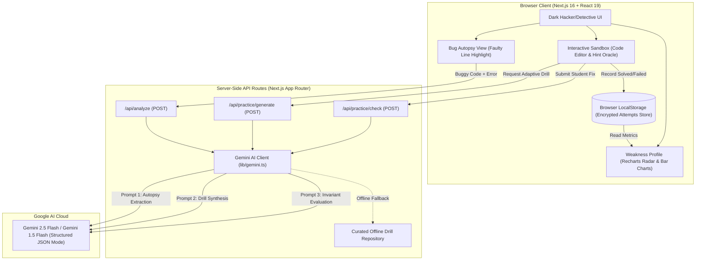
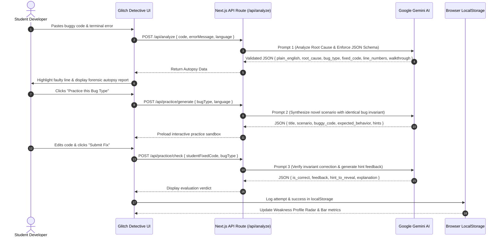

# Glitch Detective - Architecture Documentation

## Overview

**Glitch Detective** is a forensic code diagnostic and adaptive training application built for **GLITCHATHON 2026** under the **Build with AI** track. It bridges the gap between passive code copying and lifelong developer mastery by isolating the exact invariant failure in software bugs and drilling developers on identical bug archetypes.

---

## High-Level System Architecture

---

## Forensic Pipeline Workflow

---

## Core Components & Responsibilities

### 1. Presentation Layer (`components/`)
- **`Navbar.tsx`**: Navigation header with real-time status and trigger for the AI Architecture transparency modal.
- **`Hero.tsx`**: Problem definition, target audience breakdown, and quick 1-click demo entry points.
- **`CodeInputSection.tsx`**: Multi-language selection (JavaScript, Python, Java, C++), line counts, and 4 preloaded hackathon bugs.
- **`InvestigatingLoader.tsx`**: Forensic radar sweep animation signaling active background AST parsing and AI reasoning.
- **`BugAutopsy.tsx`**: Highlighted code block pinpointing the exact bug origin, plain-English summary, root-cause explanation, and copy-ready fix.
- **`PracticeMode.tsx`**: Interactive sandbox with progressive 2-stage hint oracle and instant AI verification.
- **`WeaknessProfile.tsx`**: Recharts RadarChart (multi-axis mastery polygon) and BarChart (attempts vs. solved), featured vulnerability card, and recommended practice launcher.
- **`AiArchitectureModal.tsx`**: Transparency panel detailing models, prompts, temperature, and zero-key leakage guarantees.

### 2. Forensic Server Layer (`app/api/` & `lib/`)
- **`lib/gemini.ts`**: Central client encapsulating the 3 specialized prompts, schema enforcement, zero-temperature JSON retry mechanism, and heuristic offline fallbacks.
- **`lib/types.ts`**: TypeScript definitions for the 9-archetype bug taxonomy (`off-by-one`, `null/undefined`, `type-mismatch`, `scope`, `async/promise`, `infinite-loop`, `syntax`, `logic`, `other`).
- **`lib/storage.ts`**: Client-side storage abstraction managing attempt logs and computing accuracy ratios.
- **`lib/demo-data.ts`**: Precomputed benchmark incidents for instant zero-latency demonstration.
- **`lib/practice-data.ts`**: Curated library of hands-on practice challenges across all languages.

---

## Security & Privacy Invariants

1. **Zero Key Exposure**:
   - `GEMINI_API_KEY` is loaded exclusively inside server-side Node.js route handlers.
   - The key is omitted from client bundles and never transmitted across HTTP to the browser.
2. **Deterministic Output Guarantee**:
   - Every AI request utilizes `responseMimeType: "application/json"`.
   - If an unexpected token occurs, an automatic corrective zero-temperature retry parses the AST.
3. **Student Privacy**:
   - Performance metrics and attempt counts are retained strictly inside browser `localStorage`.
   - No tracking cookies, no accounts, and no central database dependencies.
